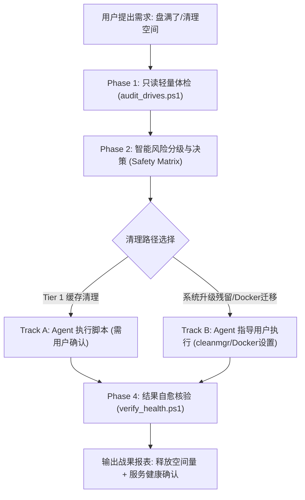

# Save My Disk 🚀 (save-my-disk)

> **Universal AI Agent Skill & Runbook for Intelligent, Non-Invasive Disk Optimization.**  
> 面向 AI 编程助手（Antigravity, OpenAI Codex, Claude Code, WorkBuddy, OpenCode, DeepSeek Harness, Cursor 等）与广大开发者的智能磁盘诊断与安全瘦身工作流。

[](LICENSE)
[](https://github.com/Sorakis/save-my-disk/actions)
[](https://github.com/Sorakis/save-my-disk/releases)
[%20%7C%20Linux%20%26%20macOS%20(Planned)-0078D6.svg)]()
[]()

---

## 🌟 核心理念 (Core Philosophy)

1. **只读优先 (Read-Only First)**：初筛体检阶段严禁执行任何写操作，严格规避死循环与高 I/O 锁盘，前台进程丝滑不卡顿。
2. **四级风险决策矩阵 (Risk-Tiered Triage)**：
   * 🟢 **Tier 1 (无痛零风险)**：系统更新补丁、`$WINDOWS.~BT`、临时文件、传递优化。
   * 🟡 **Tier 2 (开发者缓存 / 可迁移项)**：Docker 虚拟磁盘、Conda/pip/npm 缓存、AI 模型临时运行库。
   * 🟠 **Tier 3 (应用内治理与残留)**：Steam 卸载空残留、办公/聊天日志转储、微信与飞书媒体数据。
   * 🔴 **Tier 4 (绝对红线禁区)**：`System32`、`WinSxS`、正在工作的项目源码。
3. **双轨闭环执行 (Dual-Track Engine)**：
   * **Agent 自动化执行**：对零风险补丁缓存，由 Agent 提供一键脚本（**必须先获用户明确授权**）。
   * **Agent 人机协作引导**：对需要 GUI 权限的操作（如 `cleanmgr` 清理系统文件、Docker 虚拟盘无损迁移到大容量盘），Agent 输出极简分步指引。
4. **自愈与战果核验 (Verification)**：任何清理操作完成后，自动回访核对磁盘剩余空间差值，并验证关键系统服务健康状态。

---

## 🏗️ 架构与工作流 (Architecture)



---

## 🤖 多 Agent 支持规范 (Multi-Agent Compatibility)

本项目专为各大主流 AI 助手设计，即插即用：

| 平台 / Agent | 适配配置文件 | 接入方式 |
| :--- | :--- | :--- |
| **Antigravity** | [`SKILL.md`](./SKILL.md) | 作为通用技能挂载（支持通过口令显式调用） |
| **WorkBuddy / Cursor** | [`tools/tool_definitions.json`](./tools/tool_definitions.json) | OpenAPI / Function Calling 标准工具声明或直接 `@save-my-disk` |
| **Claude Code** | [`CLAUDE.md`](./CLAUDE.md) | 作为项目级指令规则即时调用 |
| **OpenAI Codex** | [`AGENTS.md`](./AGENTS.md) | 自动读取指令与 CLI 注册表 |
| **OpenCode** | [`SKILL.md`](./SKILL.md) / [`AGENTS.md`](./AGENTS.md) | 标准 Runbook 兼容模式 |
| **DeepSeek Harness** | [`AGENTS.md`](./AGENTS.md) | 结构化任务与脚本执行支持 |

---

## 📖 如何使用 (How to Use)

> **🚨 显式调用原则 (Explicit Invocation First)**：  
> 磁盘运维属于系统高危敏感操作。为了确保您的开发环境与核心文件 100% 绝对安全，**本项目严禁 AI 在普通编程时隐式静默自发运行**。您必须显式唤起本技能，Agent 会严格遵守 **“只读体检 -> 呈批候选清单 -> 靶向确认 -> 执行自愈”** 闭环。

---

### ⚡ 一键给 Agent 的安装与就绪指令 (推荐 ⭐⭐⭐⭐⭐)

你**无需手动下载配置**！直接将下面这段指令完整复制，粘贴发送给你的任意 AI 编程助手（**Antigravity、WorkBuddy、Cursor、Claude Code、OpenCode、Codex 等**）：

```text
请帮我把 https://github.com/Sorakis/save-my-disk.git 克隆到当前工作区的 .tools/save-my-disk 目录中，读取其中的 SKILL.md 与 AGENTS.md 规范；安装完成后，请向我确认已安装就绪，并询问我是否要开始执行第一次只读磁盘体检。在我明确回复同意前，请不要自动执行任何扫描或清理。
```

> **Agent 收到这句口令后会自动**：
> 1. 执行 Git 克隆将仓库拉取到工作区的 `.tools/save-my-disk`；
> 2. 识别并装载其中的多 Agent 协议与安全准则；
> 3. **礼貌停下向你确认**：“✅ `save-my-disk` 已安装就绪，请问现在是否开始只读磁盘体检？”
> 4. **必须等待你明确回复“开始”后**，AI 才会执行只读扫描并呈批候选清单，绝对不越俎代庖！

---

### 📦 手动安装方式 (Manual Installation)

如果你更习惯手动下载或希望在本机全局部署：

#### 选项 A：克隆到当前开发项目（推荐配合项目使用）
在你的项目根目录下打开终端，执行：
```bash
# 推荐克隆到工作区的工具目录
git clone https://github.com/Sorakis/save-my-disk.git .tools/save-my-disk
```

#### 选项 B：一键全局安装（让本机所有 Agent / 终端随时随地可用）
在 PowerShell 中运行以下一行命令，将工具包克隆到用户全局技能库：
```powershell
# 克隆到全局技能配置目录（以 Antigravity / 全局 Agent 规范为例）
git clone https://github.com/Sorakis/save-my-disk.git "$HOME\.gemini\config\skills\save-my-disk"
```
*安装完成后，无论你在电脑的哪个文件夹打开 AI，直接对它说：“使用 save-my-disk 技能扫描磁盘” 即可！*

---

### 💬 交互式会话流程演示 (Interactive Workflow)

#### 1. 显式唤醒与只读体检
在对话框中直接输入显式调用口令：
> **用户**：“使用 `save-my-disk` 技能，帮我只读扫描一下当前电脑的磁盘空间，看看有哪些大文件或安全残留”

AI 会自动执行只读体检脚本，严格遵循**双轨直呈规范**：
1. **通道一（对话框直接呈现 4-Tier 完整报表）**：
```markdown
### 🟢 Tier 1: 零风险系统与更新项 (Zero-Risk System & Update)
* 🟢 **[SYS-000] Windows 大版本升级备份 ($WINDOWS.~BT / Windows.old)**：0 MB (状态：健康 / 已由系统在升级 10 天后自动清理，无需操作)
* 待清理 **[SYS-001] Windows Update 补丁下载缓存**：568 MB (`C:\Windows\SoftwareDistribution\Download`)
* 待清理 **[SYS-002] 用户临时运行缓存 (Temp)**：1,003 MB (`%LOCALAPPDATA%\Temp`)

### 🟡 Tier 2: 开发者与环境大缓存 (需权衡决策)
* 决策项 **[RES-001] NVIDIA App 驱动离线安装源**：3,767 MB (删后不影响运行中显卡性能，仅重新安装驱动时需重下)
* 决策项 **[DEV-001] DeadFrontend -> node_modules**：650 MB (工程已沉睡 90 天未修改，源码 100% 受保护)

### 🟠 Tier 3: 常用软件残留与日志 (推荐清理)
* 建议清理 **[RES-002] Steam 卸载残余: Aim Lab**：1.8 MB (已卸载空目录与日志)
* 建议清理 **[RES-003] WPS 临时自动备份快照**：450 MB (用户原始文档安全保存在工作区)

### 🔴 Tier 4: 严禁触碰的保护红线
* 系统核心 (System32/WinSxS) 与工程源码库受最高级别安全免疫保护。
```

2. **通道二（提供本地可点击 Manifest 清单）**：
> “详细清理清单已同步写入本地 SSOT 文件：`[.save-my-disk/cleanup_manifest.md](file:///.../.save-my-disk/cleanup_manifest.md)`”

#### 2. 靶向授权与定向清理 (支持双重确认方式)
**AI 绝不会自动删除全部项目**。您有两种便捷确认方式：
* **方式 A (对话框直接回复)**：“确认清理 SYS-001, SYS-002 和 DEV-001，其余保留”
* **方式 B (清单文件勾选确认)**：在本地 `cleanup_manifest.md` 文件中将目标项改为 `- [x]` 保存后回复：“已勾选，按清单清理”

AI 收到您的明确授权后，才会执行底层精准清理脚本清除指定项，并汇报最终释放的容量与服务健康状态。

---

### 方式二：脱离 AI，人类开发者纯终端独立使用 (CLI Mode)

即使不借助任何 AI 工具，所有脚本也可以在 Windows PowerShell 中直接独立运行：

```powershell
# 1. 进入脚本目录
cd save-my-disk/scripts

# 2. 运行只读体检（支持查看控制台表格或输出 JSON）
.\audit_drives.ps1
.\audit_drives.ps1 -Json

# 3. 扫描软件卸载残留与应用安全缓存
.\scan_app_residues.ps1

# 4. 根据扫描出来的编号，定向安全清理（必须带 -Force 才会真正执行，否则仅 Dry-Run 预演）
.\clean_selected_residues.ps1 -TargetIds RES-001,RES-002 -Force

# 5. 安全清理 Windows Update 补丁缓存（需管理员权限，自动重启更新服务）
.\clean_windows_update.ps1
```

---

## 📂 目录结构 (Directory Layout)

```text
save-my-disk/
├── SKILL.md                  # Antigravity & OpenCode 核心技能定义
├── AGENTS.md                 # Universal Agent 规范 (Codex, WorkBuddy, DeepSeek 等)
├── CLAUDE.md                 # Claude Code 专用配置
├── README.md                 # 项目介绍与开源文档
├── LICENSE                   # MIT 开源协议
├── tools/                    # Function Calling / OpenAPI 架构定义
│   ├── tool_definitions.json # 标准函数调用工具声明
│   └── mcp.json              # MCP 插件规范配置 (WorkBuddy, Cursor 等)
├── scripts/                  # 解耦的高可用自动化脚本 (支持 -Json / -DryRun)
│   ├── audit_drives.ps1      # 只读盘符与热点体检脚本
│   ├── clean_windows_update.ps1 # 安全停止服务、清除更新补丁、自愈重启服务
│   ├── clean_user_temp.ps1   # 安全清理 Temp 目录与回收站
│   ├── scan_app_residues.ps1 # 软件残留与安全缓存扫描器
│   ├── scan_browser_system_caches.ps1 # 主流浏览器缓存与 GPU/DirectX 着色器扫描器
│   ├── scan_package_caches.ps1 # 全局包管理器缓存治理 (pip, npm, Conda, Gradle)
│   ├── scan_ai_models.ps1    # AI/ML 大模型权重与缓存透视 (Hugging Face, Ollama, PyTorch)
│   ├── scan_im_office_residues.ps1 # 国内主流通讯与办公应用深度治理 (微信 3.x/4.0, 企微, QQ, 飞书, 钉钉)
│   ├── scan_dev_artifacts.ps1 # 沉睡工程僵尸构建产物探测器 (node_modules/target/.vs)
│   ├── manage_wsl_disk.ps1   # WSL2 & Docker 虚拟硬盘(.vhdx)分析与无损压缩
│   ├── clean_selected_residues.ps1 # 基于 ID/Manifest 勾选项的精准清理器
│   ├── export_dashboard.ps1  # 零依赖单文件 HTML 可视化战报生成器 (SVG/CSS)
│   ├── menu_tui.ps1          # 纯 PowerShell 跨版本终端交互控制台 (TUI)
│   └── verify_health.ps1     # 空间差值与系统服务存活核验 (支持 -ExportHtml)
├── tests/                    # 100% 隔离的自动化 Mock 沙箱测试套件
│   └── test_mock_sandbox.ps1 # 零接触本机实际文件的验证测试
└── references/               # 离线知识库
    ├── safety_matrix.md      # 4级风险判定矩阵
    ├── cleanmgr_guide.md     # cleanmgr 系统文件清理金牌指南
    └── dev_cache_guide.md    # Docker WSL2 迁移 D 盘、Conda/Npm 治理指引
```

---

## ⚡ 真实实战战果 (Real-World Case)

在某台重度开发机器上的真实实测效果：
* **初始可用空间**：`193.90 GB`
* **清理后可用空间**：`242.20 GB`
* **净释放空间**：**+48.3 GB！**（清理了 42GB 旧系统升级残留 `$WINDOWS.~BT` 以及近 20GB 的 Windows Update 下载缓存与废弃备份）。
* **系统服务状态**：`Windows Update (wuauserv)` 验证通过，持续健康运行。

---

## 🗺️ 开源演进路线 (Roadmap)

- [x] **v0.1**: Windows 核心审计、更新缓存自愈清理、Temp/回收站清理、Cleanmgr 体系化方案、多 Agent 协议接入。
- [x] **v0.2**: 软件卸载残留扫描、NVIDIA OTA 驱动缓存治理、微信/WPS 缓存识别、持久化 Manifest 清单系统、全隔离 Mock 沙箱测试。
- [x] **v0.3.0 (正式发布 - 开发者重度环境专项治理)**:
  * WSL2 与 Docker Desktop 虚拟磁盘 (`.vhdx`) 容量分析与 `diskpart` 安全无损压缩引擎。
  * 沉睡工程僵尸构建产物探测（`node_modules`、Rust `target`、C++ `.vs`、Gradle `build`，按 60 天不活跃阈值精准筛选）。
  * 源码绝对保护屏障（`package.json`/`Cargo.toml` 与源码 100% 留存，仅清理衍生构建产物）。
  * Manifest 清单文件驱动的批量打钩清理（支持 `-FromManifest` 一键执行并在落盘标记审计账本）。
- [x] **v0.4.0 (AI 大模型与全局包管理器大缓存专项治理)**:
  * **AI/ML 存储透视 (`scan_ai_models.ps1`)**：Hugging Face 符号链接防重计引擎、Ollama 全局 Blobs 共享库检测与靶向 `ollama rm` 引导、PyTorch Checkpoints 智能归类。
  * **全局包管理缓存治理 (`scan_package_caches.ps1`)**：pip (`LOCALAPPDATA` / `PIP_CACHE_DIR`)、npm 全局下载缓存、Conda 双轨分类（Tier 1 `.tar.bz2/.conda` 压缩包 vs Tier 2 已解压 packages）、Gradle `caches/modules-2`。
  * **安全屏障与沙箱隔离**：严禁误伤 Conda 活跃环境 (`envs/`) 与工程根目录，沙箱测试全隔离拦截防本机缓存穿透。
- [x] **v0.5.1 (国内主流通讯与重度办公应用深度治理)**:
  * **微信双架构联合嗅探 (`scan_im_office_residues.ps1`)**：同时支持经典版微信 3.x (`WeChat Files`) 与全新 Qt 重构版微信 4.0 (`xwechat_files`)，反向黑名单智能枚举自定义微信号。
  * **聊天数据库双层刚性熔断机制**：`*.db`、`*.kvdb`、`db_storage`、`Msg`、`-wal`、`-shm`、`*.material` 绝对免疫；清理执行前内置递归数据库哨兵熔断检查，杜绝任何聊天记录误伤。
  * **多媒体与沉睡文档精细分级**：流媒体播放缓存与缩略图 (Tier 3) vs 超过 90 天沉睡历史文档与原图 (Tier 2 权衡项)。
- [x] **v0.5.2 (主流浏览器深层缓存与 GPU/DirectX 着色器治理)**:
  * **多浏览器缓存无损嗅探 (`scan_browser_system_caches.ps1`)**：Google Chrome, Microsoft Edge, Brave, Mozilla Firefox 多用户 Profile 探测与白名单定向发现（`Code Cache`, `GPUCache`, `DawnCache`, `cache2`）。
  * **账号密码与身份凭据红线防御**：无扩展名凭据与敏感文件哨兵 (`Login Data`, `Cookies`, `History`, `Bookmarks`, `places.sqlite`, `key4.db`) 100% 免疫，严禁嗅探与清理。
  * **GPU / DirectX 着色器缓存与 Crash Dumps 治理**：D3DSCache, NVIDIA DXCache/GLCache, AMD 着色器缓存，保留容器目录并智能容忍活跃锁定文件。
  * **100% 隔离沙箱覆盖**：沙箱全真多 Profile 模拟测试与红线对抗测试。
- [x] **v0.5.3 (可视化战报与终端交互控制台升级)**:
  * **零依赖独立 HTML 战报 (`export_dashboard.ps1`)**：纯单文件原生 HTML5 + 内联 CSS + SVG 动态环形占比图，无任何 Node/npm/CDN 外部依赖，离线/内网环境即开即显。
  * **交互式终端控制台 (`menu_tui.ps1`)**：零依赖纯 PowerShell 交互式控制台，支持全流程体检、候选清单预览、带风险二阶段强确认安全清理。
  * **自愈闭环联动刷新**：`verify_health.ps1 -ExportHtml` 支持清理完成后自动自愈验证并刷新可视化战报。
- [ ] **v0.6.0**: macOS 原生跨平台拓展 (`~/Library/Caches`, Xcode DerivedData, Homebrew cache)。

---

## 📄 开源许可证

本项目基于 [MIT License](LICENSE) 开源，欢迎自由 Fork、定制与贡献 PR！

