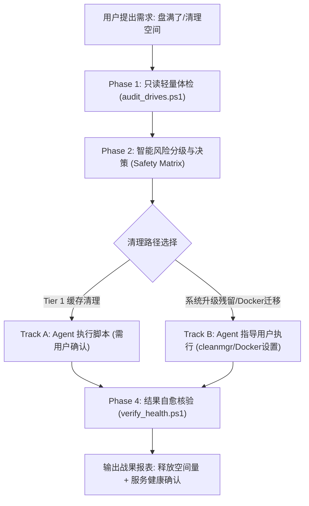

# Save My Disk 🚀 (save-my-disk)

> **Universal AI Agent Skill & Runbook for Intelligent, Non-Invasive Disk Optimization.**  
> 面向 AI 编程助手（Antigravity, OpenAI Codex, Claude Code, WorkBuddy, OpenCode, DeepSeek Harness, Cursor 等）与广大开发者的智能磁盘诊断与安全瘦身工作流。

[](LICENSE)
[%20%7C%20Linux%20%26%20macOS%20(Planned)-0078D6.svg)]()
[]()

---

## 🌟 核心理念 (Core Philosophy)

1. **只读优先 (Read-Only First)**：初筛体检阶段严禁执行任何写操作，严格规避死循环与高 I/O 锁盘，前台进程丝滑不卡顿。
2. **四级风险决策矩阵 (Risk-Tiered Triage)**：
   * 🟢 **Tier 1 (无痛零风险)**：系统更新补丁、`$WINDOWS.~BT`、临时文件、传递优化。
   * 🟡 **Tier 2 (开发者缓存 / 可迁移项)**：Docker 虚拟磁盘、Conda/pip/npm 缓存、AI 模型临时运行库。
   * 🟠 **Tier 3 (应用内治理与残留)**：Steam 卸载空残留、办公/聊天日志转储、微信与飞书媒体数据。
   * 🔴 **Tier 4 (绝对红线禁区)**：`System32`、`WinSxS`、正在工作的项目源码。
3. **双轨闭环执行 (Dual-Track Engine)**：
   * **Agent 自动化执行**：对零风险补丁缓存，由 Agent 提供一键脚本（**必须先获用户明确授权**）。
   * **Agent 人机协作引导**：对需要 GUI 权限的操作（如 `cleanmgr` 清理系统文件、Docker 虚拟盘无损迁移到大容量盘），Agent 输出极简分步指引。
4. **自愈与战果核验 (Verification)**：任何清理操作完成后，自动回访核对磁盘剩余空间差值，并验证关键系统服务健康状态。

---

## 🏗️ 架构与工作流 (Architecture)



---

## 🤖 多 Agent 支持规范 (Multi-Agent Compatibility)

本项目专为各大主流 AI 助手设计，即插即用：

| 平台 / Agent | 适配配置文件 | 接入方式 |
| :--- | :--- | :--- |
| **Antigravity** | [`SKILL.md`](./SKILL.md) | 作为通用技能自动加载（通过 YAML Frontmatter 自动意图唤起） |
| **OpenAI Codex** | [`AGENTS.md`](./AGENTS.md) | 自动读取指令与 CLI 注册表 |
| **Claude Code** | [`CLAUDE.md`](./CLAUDE.md) | 作为项目级指令规则即时调用 |
| **WorkBuddy / Cursor** | [`tools/tool_definitions.json`](./tools/tool_definitions.json) | OpenAPI / Function Calling 标准工具声明 |
| **OpenCode** | [`SKILL.md`](./SKILL.md) / [`AGENTS.md`](./AGENTS.md) | 标准 Runbook 兼容模式 |
| **DeepSeek Harness** | [`AGENTS.md`](./AGENTS.md) | 结构化任务与脚本执行支持 |

---

## 📂 目录结构 (Directory Layout)

```text
save-my-disk/
├── SKILL.md                  # Antigravity & OpenCode 核心技能定义
├── AGENTS.md                 # Universal Agent 规范 (Codex, WorkBuddy, DeepSeek 等)
├── CLAUDE.md                 # Claude Code 专用配置
├── README.md                 # 项目介绍与开源文档
├── LICENSE                   # MIT 开源协议
├── tools/                    # Function Calling / OpenAPI 架构定义
│   └── tool_definitions.json # 标准函数调用工具声明
├── scripts/                  # 解耦的高可用自动化脚本 (支持 -Json / -DryRun)
│   ├── audit_drives.ps1      # 只读盘符与热点体检脚本
│   ├── clean_windows_update.ps1 # 安全停止服务、清除更新补丁、自愈重启服务
│   ├── clean_user_temp.ps1   # 安全清理 Temp 目录与回收站
│   ├── scan_app_residues.ps1 # 软件残留与安全缓存扫描器
│   ├── clean_selected_residues.ps1 # 基于 ID/路径的精准清理器
│   └── verify_health.ps1     # 空间差值与系统服务存活核验
├── tests/                    # 100% 隔离的自动化 Mock 沙箱测试套件
│   └── test_mock_sandbox.ps1 # 零接触本机实际文件的验证测试
└── references/               # 离线知识库
    ├── safety_matrix.md      # 4级风险判定矩阵
    ├── cleanmgr_guide.md     # cleanmgr 系统文件清理金牌指南
    └── dev_cache_guide.md    # Docker WSL2 迁移 D 盘、Conda/Npm 治理指引
```

---

## ⚡ 真实实战战果 (Real-World Case)

在某台重度开发机器上的真实实测效果：
* **初始可用空间**：`193.90 GB`
* **清理后可用空间**：`242.20 GB`
* **净释放空间**：**+48.3 GB！**（清理了 42GB 旧系统升级残留 `$WINDOWS.~BT` 以及近 20GB 的 Windows Update 下载缓存与废弃备份）。
* **系统服务状态**：`Windows Update (wuauserv)` 验证通过，持续健康运行。

---

## 🗺️ 开源演进路线 (Roadmap)

- [x] **v0.1**: Windows 核心审计、更新缓存自愈清理、Temp/回收站清理、Cleanmgr 体系化方案、多 Agent 协议接入。
- [x] **v0.2 (Preview/Design)**: 软件卸载残留扫描、办公/聊天日志转储安全清理、隔离沙箱自动化测试套件、Function Calling OpenAPI 声明。
- [ ] **v0.3**: Docker / WSL 虚拟硬盘跨盘无损迁移脚本与自动化压缩 (`compact`)。
- [ ] **v0.4**: macOS 平台支持 (`~/Library/Caches`, Xcode DerivedData, Homebrew cache)。
- [ ] **v0.5**: Linux 平台支持 (`/var/cache/apt`, journalctl 日志修剪, Docker system prune)。

---

## 📄 开源许可证

本项目基于 [MIT License](LICENSE) 开源，欢迎自由 Fork、定制与贡献 PR！

